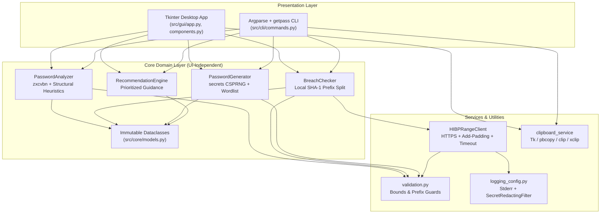
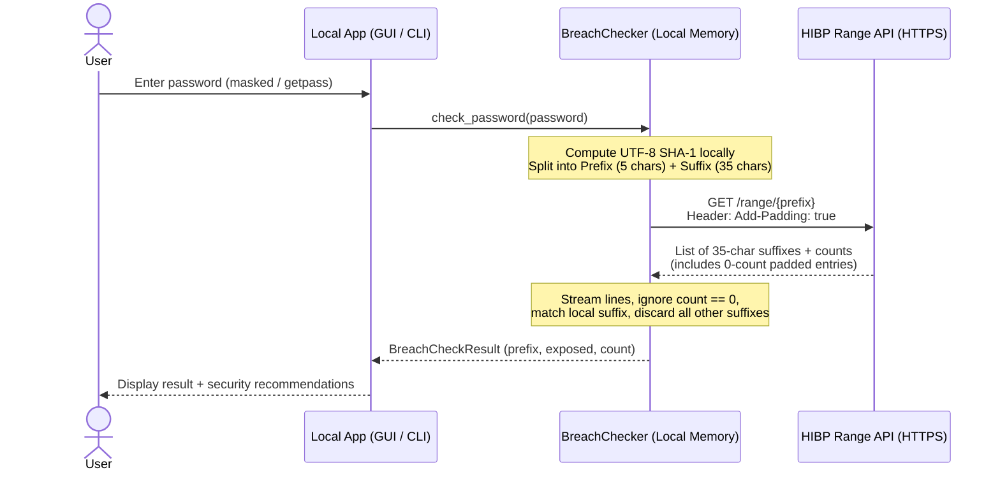

# Password Security Lab

[](https://www.python.org/downloads/)
[](https://docs.python.org/3/library/tkinter.html)
[](https://github.com/dwolfhub/zxcvbn-python)
[](https://haveibeenpwned.com/API/v3#PwnedPasswords)
[](tests/)
[](https://docs.astral.sh/ruff/)
[](LICENSE)

A local-first, privacy-focused Python desktop and CLI application for evaluating password quality, checking breach exposure using **Have I Been Pwned (HIBP) k-anonymity**, and generating cryptographically random passwords and passphrases.

> [!IMPORTANT]
> **Educational & Defensive Scope**
>
> Password Security Lab is an educational password-security assessment tool. A password not found in the HIBP dataset is **not** guaranteed to be safe, and a strength score is an estimate rather than a security guarantee. This tool is not a certified security product and is not a replacement for a dedicated password manager.

---

## Table of Contents

- [Project Overview](#1-project-overview)
- [Visual Showcase](#2-visual-showcase)
- [Core Features](#3-core-features)
- [Architecture & Data Flow](#4-architecture--data-flow)
- [Technology Stack](#5-technology-stack)
- [How Password-Strength Assessment Works](#6-how-password-strength-assessment-works)
- [How HIBP k-Anonymity Works](#7-how-hibp-k-anonymity-works)
- [Privacy & Security Design](#8-privacy--security-design)
- [Installation & Setup](#9-installation--setup)
- [Desktop GUI Usage](#10-desktop-gui-usage)
- [CLI Usage & Examples](#11-cli-usage--examples)
- [Testing & Linting](#12-testing--linting)
- [Known Limitations & Future Improvements](#13-known-limitations--future-improvements)
- [Official References & Attribution](#14-official-references--attribution)

---

## 1. Project Overview

Users routinely rely on rigid composition rules (such as forcing one uppercase letter, one number, and one symbol into a short word) that still produce predictable passwords like `Summer2024!`. At the same time, pasting real passwords into untrusted online "password strength" websites creates serious confidentiality risks.

**Password Security Lab** demonstrates how modern defensive tooling addresses both issues by answering five core questions without risking credential exposure:

1. **How strong or weak is this password?** (`Very Weak` to `Very Strong` via `zxcvbn` guessability heuristics)
2. **Does it contain predictable patterns?** (common passwords, dictionary words, leet substitutions, keyboard walks, sequential runs, repeated characters, dates)
3. **Has it appeared in the HIBP Pwned Passwords dataset?** (checked privately via 5-character prefix k-anonymity)
4. **If exposed, how frequently does it appear?** (occurrence count matched strictly in local memory)
5. **What defensive actions should be taken next?** (prioritized, actionable recommendations)

---

## 2. Visual Showcase

### Desktop GUI — Weak & Exposed Assessment + Random Password Generator

Evaluating a weak synthetic test password (`password123`, masked by default) displays a `VERY WEAK` (`0 / 4`) rating, segmented strength bar, pattern findings (`Common Password`, `Short Length`, `Sequential Characters`), and a 20-character CSPRNG password ready to copy.


### Desktop GUI — HIBP k-Anonymity Breach Result & Tailored Recommendations

Scrolling to the lower section shows the **HIBP Breach Exposure (k-Anonymity)** card (transmitting only the 5-character SHA-1 prefix `CBFDA` with `Add-Padding: enabled`), prioritized `[CRITICAL]`, `[HIGH]`, `[MEDIUM]`, and `[BEST PRACTICE]` recommendations, and the built-in privacy summary. *(Note: the breach occurrence count in this offline screenshot was simulated with a mock HIBP response.)*


### Desktop GUI — Strong Passphrase Generation & Assessment

Switching the generator to **Passphrase (Wordlist)** mode creates a 5-word passphrase (`Edge-Format3-Geode-Factor-Daring`) with capitalization and an appended digit, which evaluates offline as `VERY STRONG` (`4 / 4`) with an emerald meter and clean HIBP status banner.


---

## 3. Core Features

- **Offline Password Strength Assessment (`PasswordAnalyzer`)**
  - Combines `zxcvbn` guessability estimation (scores `0–4`, $\log_{10}$ guesses, offline slow-hash time estimate) with structural heuristics (length, unique characters, character classes, consecutive repeats, ASCII sequences, and QWERTY keyboard walks).
  - Supports long passphrases without penalizing them for omitting arbitrary symbol rules, plus full Unicode support.
  - Never echoes the evaluated password in findings, errors, or logs.
- **HIBP k-Anonymity Breach Checker (`BreachChecker` + `HIBPRangeClient`)**
  - Computes UTF-8 uppercase SHA-1 locally and transmits **only the first 5 hex characters** over HTTPS to `https://api.pwnedpasswords.com/range/{prefix}`.
  - Sends `Add-Padding: true`, skips zero-count dummy entries, and discards all unrelated suffixes immediately after local comparison.
  - Handles timeouts, network outages, HTTP errors, and malformed responses gracefully without crashing.
- **Cryptographic Password & Passphrase Generator (`PasswordGenerator`)**
  - Powered exclusively by Python's `secrets` CSPRNG (`secrets.choice`, `secrets.randbelow`).
  - **Password mode**: configurable length (`8–128`), selectable uppercase/lowercase/digits/symbols, and optional exclusion of visually ambiguous characters (`I`, `O`, `l`, `0`, `1`).
  - **Passphrase mode**: `4–12` words drawn from a bundled curated lowercase wordlist (`src/core/wordlist.py`), configurable separator (`-`, `_`, `.`, space, or custom up to 3 chars), optional capitalization, and optional appended digit.
  - Cross-platform clipboard support (`pbcopy`, `clip`, `wl-copy`, `xclip`, `xsel`, or Tk clipboard) with a reminder to store secrets in a reputable password manager.
- **Dual Interface: Tkinter Desktop Dashboard & `argparse` CLI**
  - Responsive Tkinter (`ttk`) desktop UI with masked input (`•`), show/hide toggle, non-blocking background worker thread for HIBP checks, and live strength meter.
  - Security-hardened CLI using `getpass` hidden terminal prompts (or single-line piped `stdin`) and zero `--password` flags.

---

## 4. Architecture & Data Flow

### Layered Component Architecture

The core defensive modules have no dependency on Tkinter or `argparse`, allowing identical behavior across the GUI, CLI, and test suite:



### HIBP k-Anonymity Lookup Flow



### Repository Layout

```text
password-security-lab/
├── main.py                              # Unified CLI & GUI entry point
├── pyproject.toml                       # Package metadata, pytest, and ruff config
├── requirements.txt                     # Runtime dependencies (requests, zxcvbn)
├── README.md                            # Project documentation
├── LICENSE                              # MIT License
├── .env.example                         # Optional non-secret timeout example
├── .gitignore
├── docs/
│   └── screenshots/                     # Captured desktop GUI screenshots
│       ├── gui-weak-exposed.png
│       ├── gui-breach-recommendations.png
│       └── gui-strong-passphrase.png
├── src/
│   ├── __init__.py
│   ├── core/
│   │   ├── __init__.py
│   │   ├── models.py                    # Frozen dataclasses (never store passwords)
│   │   ├── password_analyzer.py         # zxcvbn + structural pattern heuristics
│   │   ├── breach_checker.py            # Local SHA-1 split + suffix comparison
│   │   ├── password_generator.py        # secrets-based password & passphrase generator
│   │   ├── wordlist.py                  # Bundled curated lowercase passphrase wordlist
│   │   └── recommendations.py           # Prioritized defensive guidance engine
│   ├── services/
│   │   ├── __init__.py
│   │   ├── hibp_client.py               # HTTPS HIBP range client with Add-Padding
│   │   └── clipboard_service.py         # Cross-platform clipboard helper
│   ├── cli/
│   │   ├── __init__.py
│   │   └── commands.py                  # argparse subcommands with getpass prompts
│   ├── gui/
│   │   ├── __init__.py
│   │   ├── app.py                       # Tkinter dashboard and background worker
│   │   └── components.py                # Custom ttk theme, cards, scroll container, meter
│   └── utils/
│       ├── __init__.py
│       ├── validation.py                # Input and generator option bounds validation
│       └── logging_config.py            # Stderr-only logging with SecretRedactingFilter
└── tests/
    ├── __init__.py
    ├── test_password_analyzer.py
    ├── test_breach_checker.py
    ├── test_password_generator.py
    ├── test_validation.py
    ├── test_privacy.py
    └── test_cli.py
```

---

## 5. Technology Stack

| Component | Technology | Role |
| :--- | :--- | :--- |
| **Language** | Python 3.11+ (tested on 3.13) | Core runtime, type annotations, dataclasses |
| **Desktop GUI** | Tkinter (`ttk`, `clam` theme) | Cross-platform desktop dashboard |
| **CLI** | `argparse` & `getpass` | Subcommand interface with hidden password prompts |
| **Strength Estimation** | `zxcvbn` | Pattern matching and guessability scoring |
| **HTTP Client** | `requests` | HTTPS calls to the HIBP Pwned Passwords range API |
| **Cryptography / Hashing** | `secrets`, `hashlib` (stdlib) | CSPRNG generation and local SHA-1 prefixing |
| **Testing & Quality** | `pytest`, `ruff` | Automated unit/integration tests, linting, formatting |

---

## 6. How Password-Strength Assessment Works

Instead of checking only whether a password satisfies rigid character-class rules, `PasswordAnalyzer` evaluates realistic guessability:

1. **Pattern & Dictionary Matching (`zxcvbn`)**: Detects common breached passwords, dictionary words, names, dates, leet substitutions (e.g., `@` for `a`, `0` for `o`), spatial keyboard patterns, numeric/alphabetic sequences, and repeated substrings.
2. **Structural Heuristics**: Tracks full length (`1–1024` characters), unique character count, active character classes (including whitespace and Unicode), runs of 3+ identical characters, 3+ ascending/descending ASCII runs, and 4+ key QWERTY row walks.
3. **Passphrase Awareness**: Long multi-word passphrases are scored on length and unpredictability rather than failing arbitrary symbol requirements.
4. **Rating Scale**: Maps the `0–4` score to `Very Weak`, `Weak`, `Fair`, `Strong`, or `Very Strong`, alongside $\log_{10}$ estimated guesses and offline slow-hashing crack time (`10^4` guesses/sec). Note that `zxcvbn` evaluates pattern matching on up to the first **72 characters**, while full length and structural checks cover the complete input.

---

## 7. How HIBP k-Anonymity Works

Have I Been Pwned provides a k-anonymity range endpoint so you can verify breach exposure without transmitting your password or complete hash.

**Step-by-step walkthrough** using the synthetic test input `password`:

1. **Local UTF-8 SHA-1 Hash**:
   `SHA1("password")` = `5BAA61E4C9B93F3F0682250B6CF8331B7EE68FD8`
2. **Local Prefix/Suffix Split**:
   - **Prefix (transmitted)**: `5BAA6` (first 5 uppercase hex characters)
   - **Suffix (kept strictly local)**: `1E4C9B93F3F0682250B6CF8331B7EE68FD8` (remaining 35 characters)
3. **HTTPS Range Request**:
   `GET https://api.pwnedpasswords.com/range/5BAA6` with `Add-Padding: true` and `allow_redirects=False`.
4. **Local Matching & Disposal**:
   HIBP returns matching suffixes and breach counts (plus `0`-count padding entries). The client parses each line, ignores `count == 0`, compares the 35-character suffix locally, and immediately discards all other suffixes.

> [!NOTE]
> SHA-1 is used **solely** because the HIBP Pwned Passwords range API indexes entries by SHA-1 prefix (`usedforsecurity=False` in `hashlib.sha1`). SHA-1 is **not** secure for password storage or encryption.

---

## 8. Privacy & Security Design

- **Zero Disk Persistence**: No plaintext passwords, SHA-1 hashes, breach responses, history, or generated secrets are ever written to disk or databases.
- **Redacted `stderr`-Only Logging**: Logging writes only to `stderr` at `WARNING`+ and passes through `SecretRedactingFilter` (`src/utils/logging_config.py`), which strips 40-char SHA-1 hashes, 35-char suffixes, and secret key-value patterns.
- **No CLI Password Flags**: The CLI omits `--password` flags so secrets never appear in shell history or `ps` process listings.
- **Minimal Network Surface**: The only external endpoint is `https://api.pwnedpasswords.com/range/{prefix}` (HTTPS enforced, redirects disabled, configurable timeout, `Add-Padding: true`).
- **CSPRNG Only**: Secret generation relies strictly on Python's `secrets` module (`secrets.choice` and `secrets.randbelow`), never `random`.
- **Masked UI & Non-Echoing Errors**: The GUI masks input by default (`•`), and validation errors never echo password contents.

---

## 9. Installation & Setup

### Prerequisites

Ensure **Python 3.11 or newer** and **Tkinter** are installed:

- **macOS (Homebrew)**:
  ```bash
  brew install python@3.13 python-tk@3.13
  ```
- **Windows**:
  Install Python 3.11+ from [python.org](https://www.python.org/downloads/) and ensure **"tcl/tk and IDLE"** is selected during setup.
- **Linux (Debian / Ubuntu)**:
  ```bash
  sudo apt update && sudo apt install -y python3 python3-venv python3-tk
  ```
- **Linux (Fedora)**:
  ```bash
  sudo dnf install -y python3 python3-tkinter
  ```

### Virtual Environment & Dependencies

**macOS / Linux**:
```bash
cd password-security-lab
python3.13 -m venv .venv
source .venv/bin/activate
pip install -r requirements.txt
```

**Windows (PowerShell)**:
```powershell
cd password-security-lab
py -3.13 -m venv .venv
.\.venv\Scripts\Activate.ps1
pip install -r requirements.txt
```

To include development tools (`pytest` and `ruff`):

```bash
pip install -e ".[dev]"
```

---

## 10. Desktop GUI Usage

Launch the Tkinter desktop application:

```bash
python main.py gui
```

From the dashboard you can:
- Enter a password (masked by default, with a **Show** toggle and **Clear** button).
- Click **Analyze Strength (Offline)** for instant local `zxcvbn` + heuristic evaluation.
- Click **Check HIBP Breach Exposure** to run a background k-anonymity lookup without freezing the UI.
- Generate random passwords (`8–128` chars) or multi-word passphrases (`4–12` words) and copy them with **Copy to Clipboard**.

---

## 11. CLI Usage & Examples

### View Available Commands

```bash
python main.py --help
```

```text
usage: main.py [-h] COMMAND ...

Password Security Lab — Local-first educational password strength analyzer,
HIBP k-anonymity checker, and cryptographic password generator.

positional arguments:
  COMMAND
    gui       Launch the Tkinter desktop application.
    assess    Assess password strength offline (uses hidden getpass prompt).
    check     Check password exposure against HIBP k-anonymity API (exit code
              0=not found, 2=exposed, 1=error).
    generate  Generate a cryptographically random password or passphrase using
              secrets.

options:
  -h, --help  show this help message and exit

Privacy note: Passwords are requested securely via hidden terminal input
(getpass) and are never accepted as CLI flags, logged, or saved.
```

### Assess a Password Offline (`assess`)

Prompts via hidden `getpass` input (or reads one line when piped via `stdin`):

```bash
python main.py assess
```

Example output for synthetic test input `Summer2024!`:

```text
=== Password Strength Assessment ===
Rating:             Fair (Score: 2/4)
Length:             11 characters (9 unique)
Character classes:  lowercase, uppercase, digits, symbols
Estimated guesses:  ~10^7.44
Offline slow hash:  46 minutes

Findings:
  - [HIGH] Common Password: Matches or embeds a frequently used password from common-password lists.
  - [WARNING] Short Length: Length is 11 characters; 14+ characters (or a multi-word passphrase) provides substantially better resistance.

Estimator Warnings:
  - This is similar to a commonly used password.

Estimator Suggestions:
  - Add another word or two. Uncommon words are better.
  - Capitalization doesn't help very much.

Note: This rating is an estimate based on guessability heuristics and known patterns, not a guarantee that a password cannot be guessed or compromised.

=== Security Recommendations ===
  [MEDIUM] Increase length and remove predictable patterns
      Extend the password to at least 14-16 characters or switch to a randomly generated passphrase without common words or sequences.
  ...
```

Combine offline analysis with an HIBP k-anonymity lookup:

```bash
python main.py assess --check-breach --timeout 10
```

### Check Breach Exposure Only (`check`)

Returns exit code `0` (not found), `2` (exposed), or `1` (network/validation error):

```bash
python main.py check
```

Optional flags: `--timeout <seconds>` (default `10.0`) and `--no-padding`.

### Generate Random Passwords & Passphrases (`generate`)

Generate a 20-character random password:

```bash
python main.py generate --length 20
```

```text
=== Generated Secret ===
Mode:               password
Length:             20 characters
Options:            uppercase, lowercase, digits, symbols
Estimated entropy:  ~128.5 bits
Value:              _$O&XGd4$P/bjY=t}1/6

Reminder: Generated passwords are never saved automatically. Store this secret in a reputable password manager rather than relying on memory or plain files.
```

Generate a 5-word capitalized passphrase with an appended digit and copy to clipboard (`--copy`):

```bash
python main.py generate --passphrase --words 5 --capitalize --include-number --copy
```

```text
=== Generated Secret ===
Mode:               passphrase
Length:             34 characters
Options:            wordlist, capitalized, digit
Estimated entropy:  ~51.3 bits
Value:              Earth-Anchor2-Fountain-Arbor-Glade

Reminder: Generated passwords are never saved automatically. Store this secret in a reputable password manager rather than relying on memory or plain files.
```

Additional password-mode flags: `--no-uppercase`, `--no-lowercase`, `--no-digits`, `--no-symbols`, `--exclude-ambiguous`.
Additional passphrase-mode flags: `--words <4-12>`, `--separator <str>`.

---

## 12. Testing & Linting

All 37 automated tests mock HIBP network calls and use synthetic test strings only:

```bash
pytest -v
ruff check .
ruff format --check .
```

Test coverage spans:
- `tests/test_password_analyzer.py` — scoring, pattern heuristics, Unicode, passphrase profile, >72-char handling
- `tests/test_breach_checker.py` — SHA-1 prefix splitting, `Add-Padding` zero-count filtering, error handling
- `tests/test_password_generator.py` — `secrets` usage, character-set guarantees, ambiguous exclusion, passphrase options
- `tests/test_validation.py` — bounds and prefix/suffix validation
- `tests/test_privacy.py` — log redaction, zero password echoing, CLI flag safety
- `tests/test_cli.py` — `assess`, `check`, and `generate` command behavior and exit codes

---

## 13. Known Limitations & Future Improvements

### Known Limitations

- `zxcvbn` performs pattern matching on up to the first **72 characters**; full length and structural checks are still evaluated across the entire input (up to `1024` characters).
- A password absent from HIBP Pwned Passwords may still appear in private, unindexed, or newly disclosed breaches.
- Strength scores estimate resistance against common guessing models and do not protect against phishing, keyloggers, credential reuse, or weak server-side hashing.
- Passphrase entropy estimates assume uniform random selection from the bundled 564-word lowercase list (`~9.14` bits per word).

### Future Improvements

- Optional local custom context words (e.g., site name or username) passed strictly in memory to `zxcvbn`.
- Anonymized assessment report export (containing zero passwords or hashes) for security education workshops.
- High-contrast / dark-mode theme toggle and extended localization in the Tkinter desktop UI.

---

## 14. Official References & Attribution

### Official References

- [Have I Been Pwned API v3 — Pwned Passwords Range Search](https://haveibeenpwned.com/API/v3#PwnedPasswords)
- [NIST Special Publication 800-63B — Digital Identity Guidelines (Memorized Secrets)](https://pages.nist.gov/800-63-3/sp800-63b.html)
- [OWASP Authentication Cheat Sheet](https://cheatsheetseries.owasp.org/cheatsheets/Authentication_Cheat_Sheet.html)
- [Python `secrets` Module Documentation](https://docs.python.org/3/library/secrets.html)
- [Python `hashlib` Module Documentation](https://docs.python.org/3/library/hashlib.html)

### Inspiration & Attribution

This project was inspired by the educational concept of [mviana-labs/secure-password-lab](https://github.com/mviana-labs/secure-password-lab). All architecture, source code, user interface, CLI, automated tests, and documentation in this repository are original implementations authored independently for educational defensive-security purposes.
